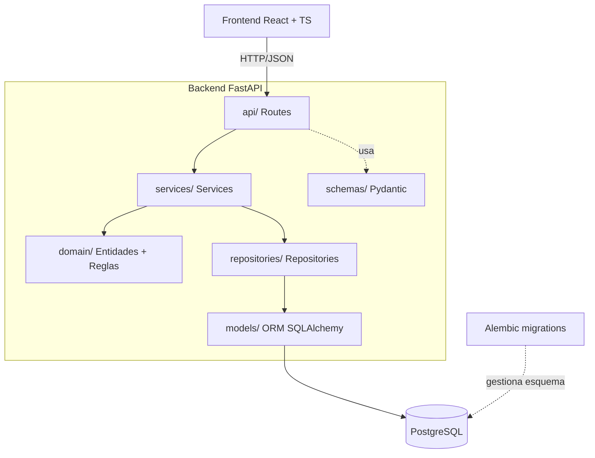
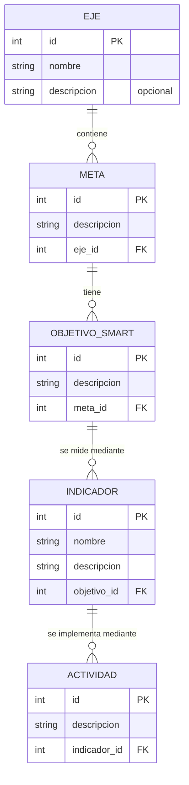

# Design Document

Documento de Diseño — Seguimiento de la Estructura ENCA (enca-strategy-tracking)

> Este diseño es una **traducción técnica** de los requisitos aprobados en
> `.kiro/specs/enca-strategy-tracking/requirements.md`. No amplía el alcance.
> Las decisiones no fijadas por el Steering ni por los requisitos se marcan como
> `TECHNICAL_DECISION`; las que dependen de información de SAO se marcan como
> `PENDING_VALIDATION` y no se inventan.
>
> Alineado con: `product.md`, `tech.md`, `structure.md`, `data-and-domain.md`,
> `data-inventory.md`, `docs/data/conceptual-data-model.md` y
> `docs/decisions/ADR-001-stack-tecnologico.md`.

## Overview

El objetivo de esta Spec es implementar el **núcleo funcional** que permite
**registrar**, **consultar** y **navegar** la jerarquía confirmada de la ENCA 2030:

```text
Eje → Meta → Objetivo SMART → Indicador → Actividad
```

El sistema cubre únicamente tres operaciones sobre cada entidad:

- **Crear** una entidad (y, para las entidades hijas, asociarla a un padre existente).
- **Consultar** una entidad por su identificador.
- **Consultar colecciones**: la colección de hijos de un padre y, para el Eje, la lista
  completa de Ejes.
- **Navegar** la jerarquía completa de un Eje como un árbol anidado.

Quedan **explícitamente fuera de alcance** (según requirements.md "Fuera de alcance"):
actualización (update), eliminación (delete), bibliometría, clasificación de artículos,
relación Artículo↔OFC, Regiones, Progreso regional, Actores, autenticación, roles y
dashboards analíticos. Los atributos `PENDING_VALIDATION` de Indicador y Actividad no
se implementan ni se exponen en los contratos.

### Alineación con el stack (ADR-001, tech.md)

| Capa                | Tecnología                                             |
| ------------------- | ------------------------------------------------------ |
| Backend / API       | Python 3.12+, FastAPI                                  |
| Validación/contratos| Pydantic                                               |
| Acceso a datos / ORM| SQLAlchemy                                             |
| Migraciones         | Alembic                                                |
| Base de datos       | PostgreSQL                                             |
| Frontend            | React + TypeScript                                     |
| Testing backend     | pytest                                                 |
| Testing frontend    | `PENDING_VALIDATION` (tech.md §22)                     |
| Ejecución           | Local                                                  |

Principio rector (tech.md §33, §40): el diseño se mantiene **simple y proporcional**
al alcance de esta primera Spec. No se introducen microservicios, colas, cachés
distribuidas ni abstracciones especulativas.

---

## Architecture

### Separación de capas

El backend respeta estrictamente la separación de responsabilidades definida en
`tech.md` §28 y `structure.md` §6/§29. La dirección de dependencias apunta siempre
hacia el dominio; el dominio no depende del framework.

```text
Frontend (React + TS)
        │  HTTP/JSON
        ▼
┌───────────────────────────────────────────────┐
│ Backend (FastAPI)                               │
│                                                 │
│  Routes (api/)                                  │
│     ↓   valida contrato (Pydantic), traduce     │
│         errores de dominio → HTTP               │
│  Services (services/)                           │
│     ↓   orquesta casos de uso, reglas de        │
│         aplicación (p. ej. "padre debe existir")│
│  Domain (domain/)                               │
│     ↓   entidades/reglas de dominio puras,      │
│         independientes de framework y ORM       │
│  Repositories (repositories/)                   │
│     ↓   acceso a datos vía SQLAlchemy           │
│  Models (models/) ──► PostgreSQL                │
└───────────────────────────────────────────────┘
```

Responsabilidad de cada capa:

- **Routes (`backend/src/api/`)**: define los endpoints FastAPI. Recibe y valida el
  contrato de entrada con Pydantic (campos obligatorios, no nulos, no vacíos tras
  recortar espacios), invoca el servicio correspondiente y traduce los resultados y
  las excepciones de dominio a respuestas HTTP (incluyendo códigos de estado). No
  contiene reglas de negocio.
- **Services (`backend/src/services/`)**: contiene la lógica de aplicación/casos de
  uso. Coordina validaciones que requieren acceso a datos (p. ej. verificar que el
  Eje padre existe antes de crear una Meta), invoca los repositorios y aplica reglas
  de dominio. No conoce FastAPI ni HTTP.
- **Domain (`backend/src/domain/`)**: define las entidades de dominio y las reglas
  invariantes puras (p. ej. "el nombre no puede ser vacío"), más las excepciones de
  dominio (`NotFoundError`, `InvalidParentReferenceError`, `ValidationError`). No
  importa SQLAlchemy, Pydantic ni FastAPI (tech.md §28, structure.md §28).
- **Repositories (`backend/src/repositories/`)**: encapsula el acceso a datos con
  SQLAlchemy. Expone operaciones de creación, obtención por id y listado por padre.
  Es el único punto que conoce consultas y sesiones.
- **Models (`backend/src/models/`)**: modelos ORM de SQLAlchemy (persistencia). Nunca
  se exponen directamente como contrato público de la API (tech.md §5).
- **Schemas (`backend/src/schemas/`)**: contratos Pydantic (Request/Create y Response)
  separados del modelo de persistencia.
- **Core (`backend/src/core/`)**: configuración (settings vía variables de entorno,
  tech.md §19), creación de la sesión de base de datos, dependencias comunes.
- **Utils (`backend/src/utils/`)**: utilidades transversales (p. ej. normalización de
  texto para la regla "recortar espacios").

### Flujo de una petición de **creación** (ej.: crear Meta bajo un Eje)

1. **Routes**: `POST /ejes/{eje_id}/metas` recibe el cuerpo y lo valida contra
   `MetaCreate` (Pydantic). Si `descripcion` es nula/vacía/solo espacios tras recortar,
   Pydantic rechaza con `422` (Req 2.3, 8.3) y no se invoca el servicio.
2. **Services**: `MetaService.crear(eje_id, datos)` solicita al `EjeRepository` que
   confirme que el Eje existe. Si no existe, lanza `InvalidParentReferenceError`
   (Req 2.2, 8.2).
3. **Domain**: construye la entidad `Meta` aplicando sus invariantes.
4. **Repositories**: `MetaRepository.crear(...)` persiste la fila con la FK al Eje
   (integridad referencial, Req 8.1).
5. **Routes**: traduce el resultado a `MetaResponse` y responde `201 Created`
   (Req 2.1). Si el servicio lanzó `InvalidParentReferenceError`, Routes responde
   `404`/`422` (ver "Error Handling").

### Flujo de una petición de **navegación** (ej.: árbol completo de un Eje)

1. **Routes**: `GET /ejes/{eje_id}/arbol` invoca `HierarchyService.obtener_arbol(eje_id)`.
2. **Services**: solicita el Eje; si no existe lanza `NotFoundError` → `404`
   (Req 6.5). Si existe, pide a los repositorios las Metas del Eje, los Objetivos de
   cada Meta, los Indicadores de cada Objetivo y las Actividades de cada Indicador.
   Las colecciones vacías se devuelven como listas vacías, no como error (Req 6.4).
3. **Repositories**: ejecutan las consultas por padre.
4. **Services**: ensambla el árbol anidado de cinco niveles.
5. **Routes**: serializa a `EjeArbolResponse` y responde `200 OK` (Req 6.1).

> `TECHNICAL_DECISION` (navegación hija→padre, Req 6.2/6.3): la referencia al padre se
> resuelve devolviendo el `*_id` del padre en cada `Response` (p. ej. `MetaResponse.eje_id`).
> Para el Eje (raíz), el campo padre es conceptualmente inexistente y la respuesta no
> incluye referencia a padre (Req 6.3), lo que se refleja en que `EjeResponse` no tiene
> campo `*_id` de padre. No se añade un endpoint específico "obtener padre": la referencia
> ya viaja en el propio recurso, evitando endpoints especulativos.

### Estructura de carpetas del backend (structure.md §6)

```text
backend/
└── src/
    ├── api/            # Routes FastAPI (routers por entidad + jerarquía)
    ├── domain/         # Entidades y reglas puras + excepciones de dominio
    ├── services/       # Casos de uso / orquestación
    ├── repositories/   # Acceso a datos SQLAlchemy
    ├── models/         # Modelos ORM (persistencia)
    ├── schemas/        # Contratos Pydantic (Create / Response)
    ├── core/           # Config, sesión DB, dependencias
    └── utils/          # Utilidades (normalización de texto, etc.)
```

### Diagrama de componentes



---

## Components and Interfaces

Se definen cinco módulos de entidad (Eje, Meta, Objetivo, Indicador, Actividad) más un
módulo de **jerarquía**. Cada módulo de entidad sigue el mismo patrón de capas.

### Interfaces por capa (patrón común)

- **Repository** (una por entidad): `crear(entidad) -> entidad`,
  `obtener_por_id(id) -> entidad | None`, `listar_por_padre(padre_id) -> list[entidad]`.
  El `EjeRepository` añade `listar_todos() -> list[Eje]`. Los repositorios de hijas
  añaden `padre_existe(padre_id) -> bool`.
- **Service** (uno por entidad): aplica la regla "el padre debe existir" antes de crear
  (Req 2.2, 3.2, 4.2, 5.2, 8.2) y lanza excepciones de dominio para id inexistente
  (Req 1.5, 2.7, 3.7, 4.6, 5.7). Devuelve entidades de dominio.
- **Router** (uno por entidad): expone los endpoints REST, mapea Pydantic↔dominio y
  excepciones→HTTP.
- **HierarchyService** + **HierarchyRouter**: ensambla y expone el árbol de un Eje.

### Endpoints de la API

Convención: rutas REST anidadas coherentes con la jerarquía. Solo **crear** y
**consultar** (no update/delete). Códigos de error detallados en "Error Handling".

#### Ejes

| Método | Ruta           | Propósito                    | Request      | Response                | Errores        |
| ------ | -------------- | ---------------------------- | ------------ | ----------------------- | -------------- |
| POST   | `/ejes`        | Crear Eje                    | `EjeCreate`  | `EjeResponse` (201)     | 422            |
| GET    | `/ejes`        | Listar todos los Ejes        | —            | `list[EjeResponse]` (200, puede ser `[]`) | —   |
| GET    | `/ejes/{id}`   | Obtener Eje por id           | —            | `EjeResponse` (200)     | 404            |

(Req 1.1–1.5, 7.1, 7.2)

#### Metas (bajo un Eje)

| Método | Ruta                        | Propósito                 | Request       | Response                 | Errores        |
| ------ | --------------------------- | ------------------------- | ------------- | ------------------------ | -------------- |
| POST   | `/ejes/{eje_id}/metas`      | Crear Meta bajo un Eje    | `MetaCreate`  | `MetaResponse` (201)     | 404 (eje), 422 |
| GET    | `/ejes/{eje_id}/metas`      | Listar Metas de un Eje    | —             | `list[MetaResponse]` (200, puede ser `[]`) | 404 (eje) |
| GET    | `/metas/{id}`               | Obtener Meta por id       | —             | `MetaResponse` (200)     | 404            |

(Req 2.1–2.7, 8.1–8.3)

#### Objetivos SMART (bajo una Meta)

| Método | Ruta                           | Propósito                      | Request            | Response                      | Errores         |
| ------ | ------------------------------ | ------------------------------ | ------------------ | ----------------------------- | --------------- |
| POST   | `/metas/{meta_id}/objetivos`   | Crear Objetivo bajo una Meta   | `ObjetivoCreate`   | `ObjetivoResponse` (201)      | 404 (meta), 422 |
| GET    | `/metas/{meta_id}/objetivos`   | Listar Objetivos de una Meta   | —                  | `list[ObjetivoResponse]` (200, puede ser `[]`) | 404 (meta) |
| GET    | `/objetivos/{id}`              | Obtener Objetivo por id        | —                  | `ObjetivoResponse` (200)      | 404             |

(Req 3.1–3.7, 8.1–8.3)

#### Indicadores (bajo un Objetivo)

| Método | Ruta                                   | Propósito                        | Request             | Response                        | Errores             |
| ------ | -------------------------------------- | -------------------------------- | ------------------- | ------------------------------- | ------------------- |
| POST   | `/objetivos/{objetivo_id}/indicadores` | Crear Indicador bajo un Objetivo | `IndicadorCreate`   | `IndicadorResponse` (201)       | 404 (objetivo), 422 |
| GET    | `/objetivos/{objetivo_id}/indicadores` | Listar Indicadores de un Objetivo| —                   | `list[IndicadorResponse]` (200, puede ser `[]`) | 404 (objetivo) |
| GET    | `/indicadores/{id}`                    | Obtener Indicador por id         | —                   | `IndicadorResponse` (200)       | 404                 |

(Req 4.1–4.7, 8.1–8.3; los atributos PENDING_VALIDATION se omiten del contrato, Req 4.7/9.1)

#### Actividades (bajo un Indicador)

| Método | Ruta                                      | Propósito                         | Request               | Response                          | Errores               |
| ------ | ----------------------------------------- | --------------------------------- | --------------------- | --------------------------------- | --------------------- |
| POST   | `/indicadores/{indicador_id}/actividades` | Crear Actividad bajo un Indicador | `ActividadCreate`     | `ActividadResponse` (201)         | 404 (indicador), 422  |
| GET    | `/indicadores/{indicador_id}/actividades` | Listar Actividades de un Indicador| —                     | `list[ActividadResponse]` (200, puede ser `[]`) | 404 (indicador) |
| GET    | `/actividades/{id}`                       | Obtener Actividad por id          | —                     | `ActividadResponse` (200)         | 404                   |

(Req 5.1–5.8, 8.1–8.3; los atributos PENDING_VALIDATION se omiten del contrato, Req 5.8/9.2)

#### Navegación de la jerarquía

| Método | Ruta                   | Propósito                                   | Request | Response                 | Errores |
| ------ | ---------------------- | ------------------------------------------- | ------- | ------------------------ | ------- |
| GET    | `/ejes/{eje_id}/arbol` | Árbol anidado completo de un Eje (5 niveles)| —       | `EjeArbolResponse` (200) | 404     |

(Req 6.1, 6.4, 6.5)

> `TECHNICAL_DECISION` (forma del endpoint de jerarquía): se expone un único endpoint
> que devuelve el **árbol anidado completo** (Eje→Meta→Objetivo→Indicador→Actividad) en
> una sola respuesta. Alternativa considerada: navegación nivel a nivel reutilizando los
> endpoints de listado por padre (el frontend arma el árbol con varias llamadas). Se elige
> el árbol completo porque satisface directamente el Req 6.1 ("abarcando los cinco niveles")
> con una sola llamada y simplifica el drill-down del frontend. El frontend puede, además,
> usar los listados por padre para la navegación perezosa nivel a nivel (Req 7.3); ambos
> coexisten sin duplicar lógica de negocio (el árbol reutiliza los mismos repositorios).

> Nota de decisión relativa a la navegación hija→padre (Req 6.2/6.3): no se crea un
> endpoint dedicado "obtener padre". La referencia al padre (`*_id`) viaja en cada
> `Response`; el Eje raíz no incluye referencia a padre, cumpliendo Req 6.3 sin error.

---

## Data Models

Se modelan **únicamente** las cinco entidades confirmadas con **solo sus atributos
confirmados** (`conceptual-data-model.md` §2). Los atributos `PENDING_VALIDATION` de
Indicador y Actividad **no** se añaden a los modelos funcionales ni a los schemas; se
documentan como **columnas futuras no implementadas** al final de esta sección.

### Identificadores — `TECHNICAL_DECISION`

Se adopta un **entero autoincremental** como **clave primaria técnica** (`id`) de cada
tabla, generado por PostgreSQL (secuencia / `IDENTITY`).

- **Alternativa considerada**: UUID (p. ej. `uuid4`) como PK.
- **Justificación de la elección**: para una aplicación de **ejecución local**, de
  **volumen moderado** (la jerarquía ENCA no es un dataset masivo; el volumen grande
  `PENDING_VALIDATION` pertenece a la bibliometría, fuera de alcance) y sin necesidad
  actual de generar ids en el cliente ni de fusionar bases distribuidas, el entero
  autoincremental es más simple, legible en URLs y eficiente como índice/FK. El UUID
  aportaría ventajas (ids no adivinables, generación distribuida) que **no** son
  requisitos de esta Spec y añadirían complejidad sin evidencia de necesidad
  (tech.md §33). Si en el futuro se requiere exposición pública no secuencial o
  sincronización entre instancias, podrá añadirse un identificador externo (UUID/slug)
  mediante una migración, sin romper el modelo.
- El contrato de la API expone este `id` como el **identificador único** de la entidad
  (Req 8.4). "Identificador único dentro de su tipo de entidad" se garantiza por la PK.

### Reglas de integridad

- Cada entidad hija tiene una **clave foránea NOT NULL** al padre inmediato, con
  restricción de integridad referencial en PostgreSQL (Req 8.1, 8.3).
- Las relaciones son 1→N: Eje 1→N Meta; Meta 1→N Objetivo; Objetivo 1→N Indicador;
  Indicador 1→N Actividad.
- Dado que esta Spec **no** implementa delete, no se define política de borrado en
  cascada (quedaría para una Spec futura de update/delete).

### Diagrama entidad-relación (solo entidades confirmadas)



### Modelos de persistencia (SQLAlchemy) — descripción

Ubicación: `backend/src/models/`. Descripción (no se escribe código):

- **`EjeModel`** → tabla `ejes`: `id` (PK int), `nombre` (texto, NOT NULL),
  `descripcion` (texto, NULL permitido). Relación 1→N con `metas`.
- **`MetaModel`** → tabla `metas`: `id` (PK int), `descripcion` (texto, NOT NULL),
  `eje_id` (FK → `ejes.id`, NOT NULL).
- **`ObjetivoModel`** → tabla `objetivos`: `id` (PK int), `descripcion` (texto, NOT NULL),
  `meta_id` (FK → `metas.id`, NOT NULL).
- **`IndicadorModel`** → tabla `indicadores`: `id` (PK int), `nombre` (texto, NOT NULL),
  `descripcion` (texto, NOT NULL), `objetivo_id` (FK → `objetivos.id`, NOT NULL).
- **`ActividadModel`** → tabla `actividades`: `id` (PK int), `descripcion` (texto,
  NOT NULL; representa el campo confirmado "nombre/descripción"), `indicador_id`
  (FK → `indicadores.id`, NOT NULL).

### Migraciones (Alembic) — enfoque

El esquema físico se crea y evoluciona **exclusivamente** mediante **migraciones
versionadas de Alembic** (tech.md §10), ubicadas conceptualmente en
`database/migrations/` (structure.md §16). Enfoque (no se escribe la migración):

1. Una migración inicial crea las cinco tablas con sus PK, columnas confirmadas y FKs
   NOT NULL en el orden de dependencia (ejes → metas → objetivos → indicadores →
   actividades).
2. Cambios futuros (p. ej. promover un atributo `PENDING_VALIDATION` a confirmado) se
   realizan como **nuevas** migraciones, nunca modificando el esquema manualmente
   (tech.md §10).

### Contratos Pydantic (schemas) — descripción

Ubicación: `backend/src/schemas/`. Los contratos de entrada (Create) y salida (Response)
están **separados** del modelo de persistencia (tech.md §5). Regla de validación común:
un campo obligatorio es **no nulo y no vacío tras recortar espacios** (se normaliza con
`strip`; una cadena de solo espacios se considera vacía y se rechaza con error de
validación → 422). Ningún atributo `PENDING_VALIDATION` aparece en estos schemas.

| Entidad    | Create (entrada)                         | Response (salida)                                             |
| ---------- | ---------------------------------------- | ------------------------------------------------------------- |
| Eje        | `EjeCreate`: `nombre` (obligatorio), `descripcion` (opcional) | `EjeResponse`: `id`, `nombre`, `descripcion`                  |
| Meta       | `MetaCreate`: `descripcion` (obligatorio) | `MetaResponse`: `id`, `descripcion`, `eje_id`                 |
| Objetivo   | `ObjetivoCreate`: `descripcion` (obligatorio) | `ObjetivoResponse`: `id`, `descripcion`, `meta_id`           |
| Indicador  | `IndicadorCreate`: `nombre` (obligatorio), `descripcion` (obligatorio) | `IndicadorResponse`: `id`, `nombre`, `descripcion`, `objetivo_id` |
| Actividad  | `ActividadCreate`: `descripcion` (obligatorio) | `ActividadResponse`: `id`, `descripcion`, `indicador_id`     |

Notas:

- La referencia al padre (`eje_id`, `meta_id`, …) **no** viaja en el cuerpo del Create:
  se toma de la **ruta anidada** (p. ej. `/ejes/{eje_id}/metas`). Esto evita el caso
  "referencia nula/ausente en el cuerpo" (Req 8.3) para el camino normal; si se recibe
  un id de ruta inexistente, el servicio responde con error de referencia inválida
  (Req 8.2).
- `EjeResponse` **no** incluye referencia a padre (el Eje es la raíz, Req 6.3).

### Schema del árbol jerárquico

- **`EjeArbolResponse`**: `id`, `nombre`, `descripcion`, `metas: list[MetaArbol]`.
- **`MetaArbol`**: `id`, `descripcion`, `objetivos: list[ObjetivoArbol]`.
- **`ObjetivoArbol`**: `id`, `descripcion`, `indicadores: list[IndicadorArbol]`.
- **`IndicadorArbol`**: `id`, `nombre`, `descripcion`, `actividades: list[ActividadArbol]`.
- **`ActividadArbol`**: `id`, `descripcion`.

Cada lista de hijos puede ser vacía (`[]`) cuando el nodo no tiene hijos (Req 6.4). En
el árbol las referencias de padre son implícitas por el anidamiento, por lo que los
nodos anidados omiten el `*_id` del padre para evitar redundancia.

### Columnas futuras no implementadas (`PENDING_VALIDATION`)

Se documentan para preparar la evolución (Req 9.1, 9.2); **no** se crean como columnas
ni se exponen en los contratos en esta Spec:

- **Indicador**: unidad de medida, valor objetivo, valor actual, fecha de medición,
  fuente/evidencia, estado.
- **Actividad**: responsable, fecha, estado, evidencia/fuente, región.

Cuando SAO valide estos atributos, se incorporarán mediante nuevas migraciones Alembic
y nuevas versiones de los schemas (Req 9.3, 9.4: hoy toda lógica de seguimiento/progreso/
evidencias queda excluida y cualquier intento de leer/escribir estos atributos se
rechaza por no estar disponible en esta versión).

---

## Error Handling

El manejo de errores separa **errores de dominio** (lanzados por Services/Domain, sin
conocimiento de HTTP) de su **traducción a HTTP** (en la capa Routes), conforme a
`tech.md` §32 (errores detectables, registrados, comprensibles; sin exponer trazas ni
detalles sensibles).

### Excepciones de dominio y su mapeo HTTP

| Excepción de dominio             | Situación                                               | Código HTTP | Requisitos                   |
| -------------------------------- | ------------------------------------------------------- | ----------- | ---------------------------- |
| `ValidationError`                | Campo obligatorio nulo/vacío/solo espacios (vía Pydantic)| **422**     | 1.2, 2.3, 3.3, 4.3, 5.3      |
| `InvalidParentReferenceError`    | Referencia a un padre que no existe                     | **404**     | 2.2, 3.2, 4.2, 5.2, 8.2      |
| `MissingParentReferenceError`    | Referencia a padre nula/ausente                         | **422**     | 8.3                          |
| `NotFoundError`                  | Entidad o Eje (para árbol) no encontrado por id         | **404**     | 1.5, 2.7, 3.7, 4.6, 5.7, 6.5 |

> `TECHNICAL_DECISION` (código para referencia a padre inexistente): se usa **404** para
> `InvalidParentReferenceError` porque el padre es un recurso identificado por la ruta
> anidada (p. ej. `/ejes/{eje_id}/metas`) y su ausencia es un "recurso padre no
> encontrado". La validación de forma del cuerpo (Pydantic) devuelve **422**. Alternativa
> considerada: 400/409; se descarta porque 404 comunica con precisión "el padre
> referenciado no existe" y es coherente con las consultas por id del mismo recurso.

### Formato de respuesta de error

Todas las respuestas de error devuelven un cuerpo JSON uniforme y **comprensible**, sin
trazas de pila ni detalles internos (Req 7.9):

```json
{ "detail": "Mensaje comprensible", "error": "codigo_de_error" }
```

- `error` es un código estable y legible (p. ej. `parent_not_found`,
  `validation_error`, `not_found`) que el frontend puede mapear a mensajes amigables.
- Los errores se **registran** en el log del backend con contexto suficiente para
  diagnóstico (sin secretos, `tech.md` §20, §31), mientras que la respuesta al cliente
  mantiene el mensaje de alto nivel.

### Atributos PENDING_VALIDATION

Cualquier intento de leer o escribir un atributo PENDING_VALIDATION del Indicador o la
Actividad se rechaza indicando que **no está disponible en esta versión** (Req 9.4). En
la práctica, estos campos no existen en los schemas: un cuerpo que los incluya es
ignorado o rechazado por el contrato Pydantic según su configuración (`TECHNICAL_DECISION`:
se configura el modelo para **prohibir campos extra**, de modo que enviar un atributo
no reconocido produzca un 422 explícito en lugar de aceptarse silenciosamente).

---

## Frontend Design

Interfaz **sencilla** en React + TypeScript cuyo único propósito es visualizar y navegar
la jerarquía y crear entidades. **No** incluye dashboard de indicadores ni
visualizaciones analíticas (fuera de alcance). Estructura alineada con `structure.md` §5
(`frontend/src/`: `components`, `pages`, `layouts`, `services`, `hooks`, `types`,
`utils`).

### Vistas (drill-down con regreso)

Una vista por nivel; cada vista lista los hijos del nivel inmediatamente inferior y
permite crear uno nuevo (Req 7.3, 7.6):

1. **EjesPage** — lista de Ejes (vista inicial, Req 7.1); formulario "crear Eje".
2. **MetasPage** (de un Eje) — lista de Metas del Eje; formulario "crear Meta".
3. **ObjetivosPage** (de una Meta) — lista de Objetivos; formulario "crear Objetivo".
4. **IndicadoresPage** (de un Objetivo) — lista de Indicadores; formulario "crear Indicador".
5. **ActividadesPage** (de un Indicador) — lista de Actividades; formulario "crear Actividad".

Navegación por niveles con **regreso** al nivel superior previamente visitado (Req 7.6),
p. ej. mediante una ruta anidada o migas de pan simples. Al seleccionar una entidad se
muestran sus **campos confirmados** (Req 7.5).

### Componentes reutilizables (`components/`)

- `EntityList`: renderiza una colección; si está vacía muestra el mensaje "No hay
  elementos" apropiado al nivel (Req 7.2 para Ejes; Req 7.4 para hijos sin elementos).
- `EntityDetail`: muestra los campos confirmados; para cada campo confirmado con valor
  nulo o vacío muestra **"Sin información"** (Req 7.5).
- `CreateEntityForm`: formulario de creación por entidad; valida localmente que los
  campos obligatorios no estén vacíos y traduce errores de la API a mensajes amigables.
- `LoadingIndicator`, `EmptyState`, `ErrorBanner`, `DemoDataBadge`.

### Capa de servicios (`services/`)

Un cliente API tipado consume los endpoints del backend. Tipos en `types/` reflejan los
Response del backend (incluyendo que `*Response` de Indicador/Actividad **no** contiene
atributos PENDING_VALIDATION). Hooks en `hooks/` (p. ej. `useEjes`, `useMetas(ejeId)`)
encapsulan carga de datos y estados.

### Estados de carga, vacío y error

- **Carga**: mientras se espera la API se muestra `LoadingIndicator` (Req 7.7).
- **Timeout de 30 s** (`TECHNICAL_DECISION` sobre el mecanismo): cada petición usa un
  temporizador/`AbortController` con límite de **30 segundos**; al cumplirse, se
  interrumpe la espera y se muestra un mensaje de error que indica que la consulta no
  pudo completarse, **conservando la última vista válida** (Req 7.8). Alternativa
  considerada: dejar el timeout por defecto del navegador; se descarta porque el Req 7.8
  exige un límite explícito y controlado de 30 s.
- **Vacío**: `EntityList`/`EmptyState` muestran mensajes contextualizados (Req 7.2, 7.4).
- **Error de API**: `ErrorBanner` muestra un mensaje comprensible sin exponer trazas,
  ids internos ni detalles técnicos (Req 7.9), mapeando el campo `error` del backend.

### Testing de frontend

`PENDING_VALIDATION` — la librería/framework concreto de testing de frontend aún no está
decidido (`tech.md` §22). No se elige en esta Spec.

---

## DEMO_DATA

Estrategia **sencilla** y proporcional (Req 10, sin arquitectura compleja): no se crean
tablas ni colecciones separadas ni aislamiento complejo.

- **Seed de desarrollo**: un script de desarrollo (conceptualmente en `scripts/data/` o
  `database/seeds/`, `structure.md` §16/§18) inserta una jerarquía de ejemplo cuyos
  campos de texto llevan un **marcador legible DEMO_DATA**.
- **Marcador** (`TECHNICAL_DECISION`): se usa un **prefijo textual legible**
  `"[DEMO_DATA] "` al inicio del nombre/descripción de las entidades sembradas.
  Alternativa considerada: una columna booleana `is_demo` en cada tabla. Se descarta por
  ahora porque añadiría una columna a todas las tablas (más complejidad de esquema) sin
  ser requisito; el prefijo textual es legible tanto en API como en UI y no toca el
  esquema. Si en el futuro se necesita filtrar/aislar DEMO_DATA de forma programática,
  podrá promoverse a una columna mediante migración.
- **Indicación visible**: cuando el frontend detecta el marcador en un campo, muestra el
  componente `DemoDataBadge` ("Datos de demostración — no es información oficial de SAO",
  Req 10.2). Las exportaciones conservan el marcador en el texto.
- **Nunca como oficial**: el marcador viaja en los propios datos, de modo que no es
  posible presentarlos como información oficial de SAO sin que la indicación sea visible
  (Req 10.3).

---

## Testing Strategy

Las pruebas de backend usan **pytest** (`tech.md` §22), organizadas según
`structure.md` §19 en `tests/unit` (lógica de servicios/dominio y contratos, aislada
de la base de datos) y `tests/integration` (API + PostgreSQL de prueba). El alcance de
las pruebas se limita a los tipos solicitados; no se introducen marcos adicionales ni
estrategias especulativas (tech.md §33, §40). Las pruebas que tocan base de datos usan
una base de datos de prueba o sesión transaccional con rollback para mantener el
aislamiento.

### Pruebas unitarias (`tests/unit`)

- **Creación correcta** de cada entidad con datos válidos: Eje, Meta, Objetivo SMART,
  Indicador y Actividad se crean a partir de datos que respetan los campos obligatorios
  (Req 1.1, 2.1, 3.1, 4.1, 5.1).
- **Consulta individual y de colección**: obtener una entidad por un `id` existente;
  listar la colección de hijos de un padre; listar todos los Ejes; y confirmar que una
  colección **vacía** se devuelve como `[]` sin error (Req 1.3, 1.4, 2.4, 2.5, 3.4,
  4.4, 5.4, 5.5).
- **Asociación correcta hija→padre**: al crear una Meta, Objetivo, Indicador o Actividad
  bajo un padre existente, la entidad resultante referencia exactamente a ese padre
  inmediato (Req 2.1, 3.1, 4.1, 5.1, 8.1).
- **Rechazo de referencia a padre inexistente**: crear una entidad hija bajo un `id` de
  padre que no existe se rechaza (error de referencia inválida → 404) y no persiste
  ninguna entidad hija (Req 2.2, 3.2, 4.2, 5.2, 8.2).
- **Validación de campos obligatorios**: para cada campo obligatorio (nombre/descripción
  según la entidad), un valor **nulo**, **vacío** o compuesto **solo por espacios** se
  rechaza con error de validación (→ 422) y no persiste nada (Req 1.2, 2.3, 3.3, 4.3,
  5.3).
- **Navegación de la jerarquía**: el árbol de un Eje refleja la estructura creada; un
  nodo sin hijos presenta su colección de hijos como `[]` (Req 6.1, 6.4); el Eje raíz
  no incluye referencia a padre y no produce error (Req 6.3).
- **Omisión de atributos PENDING_VALIDATION**: los contratos de salida de Indicador y
  Actividad no contienen los atributos marcados como PENDING_VALIDATION, y un cuerpo que
  los incluya es rechazado (Req 4.7, 5.8, 9).

### Pruebas de respuestas de error (`tests/unit`)

- **404 recurso no encontrado**: consulta por un `id` inexistente en cada entidad y
  árbol de un Eje inexistente devuelven 404 (Req 1.5, 2.7, 3.7, 4.6, 5.7, 6.5).
- **422 validación**: cuerpos que violan los campos obligatorios (nulo/vacío/solo
  espacios) devuelven 422 (Req 1.2, 2.3, 3.3, 4.3, 5.3).
- **Referencia inválida**: referencia a un padre nulo/ausente o inexistente en la ruta
  se traduce al código de error correspondiente (404/422) (Req 8.2, 8.3).

### Pruebas de integración (`tests/integration`)

- **Integridad referencial por FK**: contra PostgreSQL, la **FK NOT NULL** impide
  referencias colgantes de entidades hijas, confirmando la asociación a nivel de base de
  datos (Req 8.1).
- **Flujo extremo a extremo**: crear una jerarquía completa (Eje→Meta→Objetivo→Indicador
  →Actividad) a través de los endpoints y recuperar el árbol anidado del Eje (Req 6.1).
- **Seed DEMO_DATA**: las entidades sembradas conservan su marcador `[DEMO_DATA]` en los
  campos de texto (Req 10).

### Testing de frontend

`PENDING_VALIDATION` — la librería/framework concreto de testing de frontend aún no está
decidido (`tech.md` §22). Las pruebas de las vistas y componentes React (Req 7.x) se
definirán cuando se seleccione el framework al configurar el proyecto frontend.

---

## Design Decisions

### 1. Decisiones derivadas directamente de los documentos (Steering / Requirements / ADR)

- **Stack**: Python 3.12+, FastAPI, Pydantic, SQLAlchemy, Alembic, PostgreSQL; frontend
  React + TypeScript; pytest en backend; ejecución local (ADR-001, `tech.md` §3–§10, §22,
  §26, §39).
- **Separación de capas** Routes → Services → Domain → Repositories → Database y dominio
  independiente del framework (`tech.md` §28, `structure.md` §6, §28, §29).
- **Estructura de carpetas** del backend y del frontend (`structure.md` §5, §6).
- **Modelo de datos**: solo las cinco entidades confirmadas con sus atributos
  confirmados y relaciones 1→N con FK (`conceptual-data-model.md` §2, §3; D-001 a D-004;
  Req 8).
- **Omitir atributos PENDING_VALIDATION** de Indicador y Actividad de los contratos y de
  la lógica (Req 4.7, 5.8, 9; `conceptual-data-model.md` §2.4, §2.5).
- **Solo crear/consultar/navegar**; sin update/delete, bibliometría, OFC, Regiones,
  Actores, autenticación (Req "Fuera de alcance").
- **Esquema vía migraciones Alembic versionadas**, sin edición manual (`tech.md` §10).
- **Validación de campos obligatorios**: no nulo y no vacío tras recortar espacios
  (Req 1.2, 2.3, 3.3, 4.3, 5.3).
- **Timeout de 30 s y "Sin información"** en el frontend (Req 7.5, 7.7, 7.8).
- **DEMO_DATA** marcado y nunca presentado como oficial (Req 10; `tech.md` §2.3,
  `data-and-domain.md` §37).

### 2. Decisiones técnicas necesarias para implementar (`TECHNICAL_DECISION`)

- **Identificadores = entero autoincremental** como PK técnica (frente a UUID),
  justificado por ejecución local, volumen moderado y simplicidad; promovible a
  identificador externo vía migración si se requiere.
- **Endpoint de jerarquía = árbol anidado completo** en una sola respuesta
  (`GET /ejes/{id}/arbol`), coexistiendo con los listados por padre para la navegación
  nivel a nivel del frontend.
- **Navegación hija→padre** mediante el campo `*_id` en cada Response (sin endpoint
  dedicado "obtener padre"); el Eje raíz omite la referencia a padre.
- **Código HTTP para referencia a padre inexistente = 404**
  (`InvalidParentReferenceError`), 422 para validación de forma (Pydantic).
- **Prohibir campos extra en los schemas Pydantic**, de modo que enviar atributos no
  reconocidos (incluidos PENDING_VALIDATION) produzca 422.
- **Marcador DEMO_DATA = prefijo textual legible `"[DEMO_DATA] "`** (frente a columna
  `is_demo`), promovible a columna vía migración si se necesita filtrado programático.
- **Mecanismo de timeout de 30 s en el frontend** vía temporizador/`AbortController`.

### 3. Decisiones que permanecen `PENDING_VALIDATION`

- **Atributos de seguimiento/evidencia** de Indicador (unidad de medida, valor objetivo,
  valor actual, fecha de medición, fuente/evidencia, estado) y de Actividad (responsable,
  fecha, estado, evidencia/fuente, región): documentados como columnas futuras no
  implementadas; su definición depende de SAO (Req 9; `data-and-domain.md` §8, §9).
- **Framework/librería de testing de frontend** (`tech.md` §22).
- **Límites de longitud** de los campos de texto: decisión técnica provisional de
  validación, a revisar con SAO antes de tratarse como regla de dominio (requirements.md
  "Decisiones técnicas provisionales"). No se inventan límites en esta Spec.
- Fuera de alcance y dependientes de SAO (no se deciden aquí): metodología bibliométrica,
  relación Artículo↔OFC, modelo de Actores, Regiones/Progreso, autenticación/roles,
  estrategia de despliegue y uso de Docker (`tech.md` §13–§15, §27, §30, §34; ADR-001).
