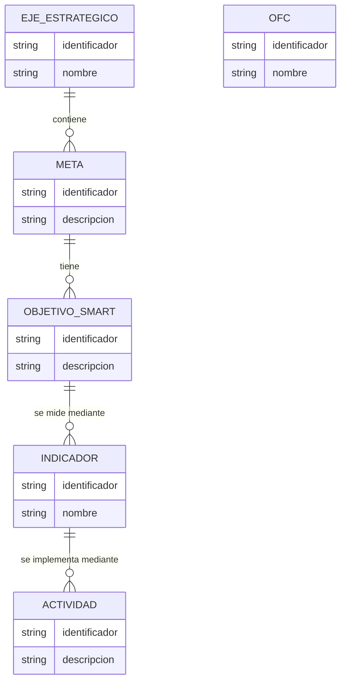

# Modelo de Datos Conceptual — SAO ENCA 2030

Estado del documento: **conceptual**
Nivel: **independiente de tecnología** (no es un esquema físico de base de datos)

Este documento describe el modelo de datos **conceptual** del proyecto. Incluye
únicamente las entidades y relaciones **confirmadas** en
`.kiro/steering/data-and-domain.md` (reglas D-001 a D-010) y el inventario
`docs/data/data-inventory.md`.

> Reglas aplicadas:
> - No se inventan entidades, campos, categorías ni relaciones no confirmadas
>   (`data-and-domain.md` §2, §35; `product.md` §22).
> - Esto NO es un esquema físico. El motor de base de datos ya está definido
>   (**PostgreSQL** con **SQLAlchemy**/**Alembic**, `tech.md` §8–§10, ADR-001),
>   pero el esquema físico todavía no se ha creado (corresponde a una Spec).
> - Los atributos listados son conceptuales; los definitivos dependen de las
>   fuentes reales y de la validación con SAO.

---

## 1. Clasificación de confiabilidad

Cada elemento se etiqueta como:

- **CONFIRMADO** — respaldado por documentos de SAO o decisión explícita.
- **INFERIDO** — relación razonable aún no confirmada como requisito.
- **PENDING_VALIDATION** — debe confirmarse con SAO antes de ser regla.

Solo las entidades **CONFIRMADO** se modelan como núcleo. Las demás se listan
aparte y NO deben convertirse todavía en tablas obligatorias.

---

## 2. Entidades confirmadas (núcleo de estrategia)

Fuente: `data-and-domain.md` §4–§11, reglas D-001 a D-006.

### 2.1 Eje estratégico — CONFIRMADO (D-001)

Línea estratégica de acción de la ENCA 2030.

Atributos conceptuales (los definitivos provienen de la fuente oficial ENCA):
- Identificador
- Nombre
- Descripción (opcional)

### 2.2 Meta — CONFIRMADO (D-001)

Resultado esperado dentro de un eje estratégico.

Atributos conceptuales:
- Identificador
- Descripción / enunciado
- (Referencia al eje)

### 2.3 Objetivo SMART — CONFIRMADO (D-002)

Objetivo específico asociado a una meta.

Atributos conceptuales:
- Identificador
- Descripción / enunciado
- (Referencia a la meta)

### 2.4 Indicador — CONFIRMADO (D-003)

Medida de seguimiento de una meta u objetivo.

Atributos conceptuales (varios `PENDING_VALIDATION`, `data-and-domain.md` §8):
- Identificador
- Nombre
- Descripción
- Unidad de medida — PENDING_VALIDATION
- Valor objetivo — PENDING_VALIDATION
- Valor actual — PENDING_VALIDATION
- Fecha de medición — PENDING_VALIDATION
- Fuente / evidencia — PENDING_VALIDATION
- Estado — PENDING_VALIDATION

### 2.5 Actividad — CONFIRMADO (D-004)

Acción propuesta para contribuir al cumplimiento de una meta u objetivo.

Atributos conceptuales (presencia no uniforme en las fuentes,
`data-and-domain.md` §9):
- Identificador
- Nombre / descripción
- Responsable — PENDING_VALIDATION
- Fecha — PENDING_VALIDATION
- Estado — PENDING_VALIDATION
- Evidencia / fuente — PENDING_VALIDATION
- Región — PENDING_VALIDATION

### 2.6 Región — CONFIRMADO como estructura de fuente (D-005)

Regiones observadas en las fuentes (`data-and-domain.md` §10):
Andina, Caribe, Insular, Orinoquía, Pacífico, Amazonía.

### 2.7 Progreso regional — CONFIRMADO como estructura de fuente (D-005)

Información de progreso asociada a regiones (`data-and-domain.md` §11).

PENDING_VALIDATION: el significado exacto de "progreso" (porcentaje, estado
cualitativo, evaluación manual), quién lo actualiza y con qué periodicidad.
La categoría "Necesitamos aumentar esfuerzos" se conserva según la fuente y no
se reinterpreta.

### 2.8 Objeto Focal de Conservación (OFC) — CONFIRMADO como referencia (D-006)

Entidad de **referencia del dominio**. Los 11 OFC definidos por la documentación
ENCA (`data-and-domain.md` §12). No se crean, modifican ni amplían.

PENDING_VALIDATION: su uso como categorías de clasificación bibliométrica y la
relación artículo ↔ OFC (ver §4).

---

## 3. Relaciones confirmadas

Fuente: `data-and-domain.md` §33 (modelo conceptual) y reglas D-001 a D-004.

    Eje estratégico
        └── contiene → Meta
              └── tiene → Objetivo SMART
                    └── se mide mediante → Indicador
                          └── se implementa mediante → Actividad

CONFIRMADO:
- Eje contiene Metas (D-001).
- Meta tiene Objetivos SMART (D-002).
- Objetivo/estrategia asociado con Indicadores (D-003).
- Actividad forma parte de la estructura de implementación (D-004).

Relación con región/progreso (D-005): CONFIRMADA como estructura de fuente. La
granularidad exacta (si el progreso cuelga de Actividad o de Indicador) es
**PENDING_VALIDATION** (`data-and-domain.md` §9, §10).

### Diagrama conceptual (confirmado)

Nota: el OFC se incluye como entidad de referencia aislada; su relación con
otras entidades es PENDING_VALIDATION y por eso NO se dibuja ninguna arista
hacia él.

---

## 4. Entidades y relaciones NO confirmadas (NO modelar todavía)

Estas aparecen en las fuentes como posibilidades, pero son INFERIDAS o
PENDING_VALIDATION. NO deben implementarse como tablas/relaciones obligatorias
(`data-and-domain.md` §20, §35; `data-inventory.md` §28).

### 4.1 Actor / Organización / Persona / Contacto — PENDING_VALIDATION

Existen fuentes (DATA-005) con personas y contactos, pero el modelo oficial de
actores no está definido (`data-and-domain.md` §13, §14). No asumir
`persona = organización`.

### 4.2 Artículo científico — PENDING_DATA_SOURCE

El dataset real no ha sido provisto (`data-and-domain.md` §18,
`data-inventory.md` DATA-012). No asumir campos (DOI, abstract, keywords, etc.).
El modelo del artículo debe adaptarse a la estructura real cuando se reciba.

### 4.3 Relación Artículo → OFC — PENDING_VALIDATION

Hipótesis de trabajo, no confirmada (`data-and-domain.md` §12, §20). No se
define todavía si un artículo pertenece a uno o varios OFC (`tech.md` §12).

### 4.4 Clasificación bibliométrica — PENDING_VALIDATION

Categorías mencionadas verbalmente ("macro", "200 mil", "30 mil", "ecología")
NO se modelan como entidades hasta recibir definición de SAO
(`data-and-domain.md` §19, `data-inventory.md` DATA-013).

### 4.5 Otras entidades de descubrimiento — PENDING_VALIDATION

Iniciativa, proyecto, sector productivo, especie, hábitat, prioridad de
investigación, vacío de conocimiento, dataset, fuente, metadato, evidencia:
listadas como descubrimiento (`data-inventory.md` §21), no como modelo
definitivo.

---

## 5. Trazabilidad y procedencia (principio transversal)

Cuando se implemente la persistencia, cada dato debería conservar su procedencia
(`data-and-domain.md` §26, `data-inventory.md` §25). A nivel conceptual:

    Dato → { Fuente, Dataset, Fecha de incorporación, Fecha de actualización, Versión }

    Resultado procesado → { Dataset origen, Pipeline, Versión del pipeline,
                            Fecha de procesamiento, Configuración/modelo }

Esto es especialmente importante para la futura información bibliométrica. No se
implementa todavía; se registra como principio de diseño.

---

## 6. Actualización temporal (principio de diseño)

La incorporación de nuevos datos NO debe destruir datos históricos
(`data-and-domain.md` §27, `data-inventory.md` §26). La estrategia de
versionamiento concreta es **PENDING_VALIDATION**.

---

## 7. Qué falta para pasar a modelo físico

- Validar atributos definitivos de Indicador y Actividad con SAO.
- Definir granularidad de progreso regional.
- Definir el modelo oficial de actores (P2).
- Recibir dataset bibliométrico y definiciones (P0).
- Crear el esquema físico en PostgreSQL mediante modelos SQLAlchemy y
  migraciones Alembic (motor ya decidido en ADR-001), dentro de una Spec.

Hasta entonces, este modelo permanece conceptual y no debe convertirse en un
esquema rígido (`data-inventory.md` §33).
